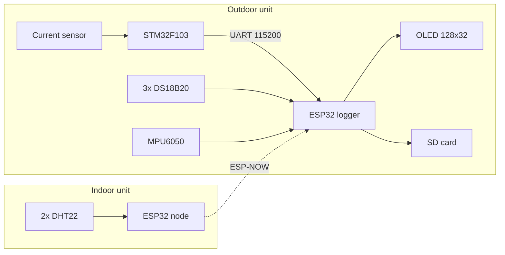

# Data-Logger-for-split-AC-system
records compressor current, vibration, refrigerant line temperatures and supply/return air conditions to an SD card, shows them live on a small OLED, and links the indoor and outdoor units wirelessly over ESP-NOW.


Use it to build a baseline for a healthy system and spot problems early: low charge, dirty filters or coils, icing, a failing compressor.

## Features

- **Compressor current**: an STM32 samples the current sensor at 3333 Hz with timer-triggered DMA and reports true RMS and peak about 17 times per second.
- **Refrigerant line temperatures**: 3× DS18B20 (liquid line, suction line, ambient).
- **Compressor vibration**: MPU6050 accelerometer, reported as a single orientation-independent RMS value in mg.
- **Supply and return air**: 2× DHT22 in the indoor unit, sent to the outdoor unit over ESP-NOW (no WiFi router needed).
- **SD card logging**: one CSV row per second, a new file on every boot, flushed every 2 s.
- **OLED display**: 128×32, three rotating pages.
- **Fault tolerant**: a failed sensor leaves a blank CSV field instead of a bogus value, and a lost wireless link is flagged rather than showing stale data.

## System overview



## Repository layout

```
.
├── stm32/                 # STM32CubeIDE project: current sampling, RMS and peak
│                          # (rmsPeak.* is MATLAB Coder output, see License)
├── outdoor_logger/
│   └── outdoor_logger.ino # ESP32: UART + DS18B20 + MPU6050 + OLED + SD + ESP-NOW receiver
├── indoor_node/
│   └── indoor_node.ino    # ESP32: 2x DHT22 + ESP-NOW sender
└── README.md
```

## Hardware

| Part | Qty | Location | Notes |
|---|---|---|---|
| STM32F103 board (Blue Pill) | 1 | Outdoor | Samples the current sensor |
| ESP32 dev board | 2 | One outdoor, one indoor | |
| Current sensor with analog output | 1 | Outdoor | Output biased to mid-supply (about 1.65 V) |
| DS18B20 (waterproof probe) | 3 | Outdoor | Liquid, suction, ambient |
| MPU6050 breakout | 1 | Outdoor | Mount on the compressor base or bracket |
| DHT22 (AM2302) | 2 | Indoor | Supply and return air |
| 0.91" SSD1306 OLED (I²C, 128×32) | 1 | Outdoor | |
| microSD module (SPI) + FAT32 card | 1 | Outdoor | |
| 4.7 kΩ resistor | 1 | Outdoor | DS18B20 data pull-up |

## Wiring

### STM32F103

| Signal | Pin |
|---|---|
| Current sensor output | PA0 (ADC1 ch0) |
| Bias reference measurement | PA5 (ADC1 ch5) |
| UART TX to ESP32 | PA9 (USART1 TX) |
| Status LED | PC13 |

Connect STM32 **PA9 to ESP32 GPIO 33** and join the grounds. Both sides are 3.3 V logic.

### Outdoor ESP32

| Device | ESP32 pin |
|---|---|
| STM32 UART RX | GPIO 33 |
| OLED + MPU6050 SDA / SCL | GPIO 27 / GPIO 26 |
| SD module SCK / MISO / MOSI / CS | GPIO 18 / 19 / 23 / 5 |
| DS18B20 data (all three in parallel) | GPIO 4, 4.7 kΩ pull-up to 3V3 |

The OLED (0x3C) and MPU6050 (0x68) share the same I²C bus.

### Indoor ESP32

| Device | ESP32 pin |
|---|---|
| DHT22 supply air | GPIO 16 |
| DHT22 return air | GPIO 17 |

All pins are `#define`s at the top of each sketch.

## Software setup

### 1. STM32 firmware

1. Open the project in STM32CubeIDE and build and flash it (ST-Link).
2. Every 60 ms the firmware sends 8 raw bytes over USART1 at 115200 8N1: `rms` (uint32, little-endian) then `peak` (uint32, little-endian). There is no header or CRC.

Sampling details: TIM3 triggers the ADC at 3333 Hz into a 400-sample circular DMA buffer. Each half-buffer (200 samples, 60 ms) is processed as it fills. At startup the firmware measures the true supply voltage from the internal VREFINT and the sensor's bias point, so readings do not depend on a perfect 3.3 V rail.

### 2. Arduino libraries

Install from the Library Manager:

- Adafruit GFX Library
- Adafruit SSD1306
- OneWire
- DallasTemperature
- DHT sensor library (Adafruit) and Adafruit Unified Sensor

Board package: **esp32 by Espressif** (core 2.x and 3.x are both supported).

### 3. Flash the outdoor logger

1. Open `outdoor_logger/outdoor_logger.ino` and flash it to the outdoor ESP32.
2. On boot it prints its **MAC address** on Serial and on the OLED. Note it down.
3. The Serial monitor (115200) also lists the **ROM address** of each DS18B20 found.

### 4. Assign the DS18B20 roles

Sensors are assigned in bus order by default, which is arbitrary. To pin each one to a role, warm one probe at a time, see which address's reading rises, and paste the addresses into `dsAddr[]` in this order: **liquid, suction, ambient**.

### 5. Flash the indoor node

1. In `indoor_node/indoor_node.ino`, set `peerMac[]` to the outdoor ESP32's MAC. The default is broadcast, which works but gives no acknowledgement or retry.
2. Flash it to the indoor ESP32. Both sketches use WiFi channel 1 (`ESPNOW_CHANNEL`); keep them identical.

## Usage

### OLED pages (3 s each)

| Page | Content |
|---|---|
| 1 | Current RMS (mA), peak (mA), vibration (mg) |
| 2 | Liquid, suction and ambient temperature |
| 3 | Supply and return temperature and humidity, return − supply ΔT. Shows `NO LINK` if the indoor node is silent for 10 s |

The bottom line shows the SD status, the packet counter and the page number.

### CSV log

A new `/log_NNNN.csv` is created on every boot.

| Column | Description |
|---|---|
| `ms` | Milliseconds since boot (there is no RTC) |
| `seq` | Count of STM32 packets received |
| `rms_mA`, `peak_mA` | Mean RMS and maximum peak over the last second |
| `vib_mg` | Compressor vibration, RMS over the last second |
| `liquid_C`, `suction_C`, `ambient_C` | DS18B20 temperatures |
| `supply_C`, `supply_RH`, `return_C`, `return_RH` | Indoor air, from the indoor node |
| `indoor_age_s` | Seconds since the last indoor packet; indoor fields go blank if over 10 s |

Blank fields mean the sensor failed or was unavailable. Remove the card after a pause of a couple of seconds, since data is flushed every 2 s.

## Reading the data

These are rules of thumb for cooling mode. Log a known-good baseline first and compare against that; the right numbers depend on your unit and refrigerant.

- **Return − supply ΔT**: roughly 8 to 12 °C is typical. A low ΔT can mean low charge, a weak compressor or a bypassing coil. A high ΔT (above about 14 °C) often means restricted airflow, such as a dirty filter or coil.
- **Suction line temperature near or below 0 °C**: the evaporator is probably icing.
- **Liquid line close to ambient, or very hot**: possible charge or condenser problem.
- **Vibration**: watch for rising trends at similar load. Inverter compressors change speed, so compare under similar conditions.
- Superheat and subcooling cannot be derived from temperatures alone. They need line pressures (see the roadmap).

## Installation tips

- **Line sensors**: strap each DS18B20 tightly to the bare copper pipe with a little thermal paste, then insulate over it.
- **Ambient sensor**: shaded, at the condenser air inlet, away from the exhaust and direct sun.
- **MPU6050**: on the compressor base plate or bracket, not the shell (the shell can exceed the sensor's 85 °C rating).
- **Supply DHT22**: downstream of the evaporator coil and out of direct water spray. Condensation shortens DHT22 life; an SHT3x is a more condensation-tolerant substitute.
- **Wireless range**: ESP-NOW usually covers indoor to outdoor through one wall. For harder paths, use an ESP32 board with an external antenna.

## Known limitations

- Units for `rms_mA` and `peak_mA` come from the `rmsPeak` scaling in the STM32 project; check that it matches your current sensor.
- The 200-sample (60 ms) window is exactly 3 cycles at 50 Hz. At 60 Hz it is 3.6 cycles, so RMS will ripple slightly.
- Timestamps are `millis()` since boot. Add a DS3231 RTC if you need wall-clock time.
- ESP-NOW packets are checked with a CRC but are not authenticated or encrypted.
- The ESP32 uses roughly 100 mA with WiFi on, so run it from a proper supply.

## License

The Arduino sketches (`outdoor_logger/`, `indoor_node/`) and the rest of this repository's original code
Exceptions:

- **MATLAB Coder-generated files** (`rmsPeak.c`, `rmsPeak.h` and any other generated sources in `stm32/`) were produced with a MATLAB **Academic License**. Their use is limited to teaching, academic research and meeting course requirements at degree-granting institutions, and is not for government, commercial or other organizational use, their use remains subject to the terms of the MathWorks license they were generated under.
- **STM32 HAL and CubeMX-generated code** remain under STMicroelectronics' license terms.
